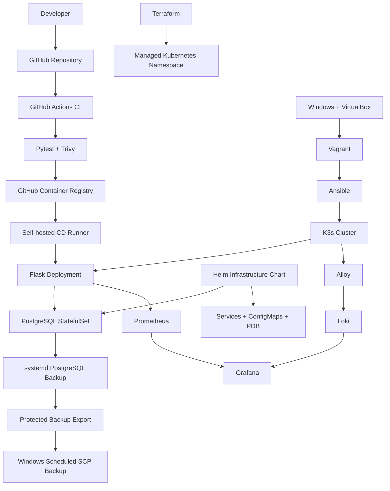

# CloudForge — System Architecture

CloudForge is a single-node, production-style DevOps lab running on an Ubuntu Server virtual machine.

## Infrastructure Overview

## Ownership Boundaries

| Component | Owner |
|---|---|
| Virtual machine provisioning | Vagrant |
| Ubuntu and K3s bootstrap | Ansible |
| Dedicated Kubernetes namespace | Terraform |
| PostgreSQL and Kubernetes infrastructure services | Helm |
| Flask deployment updates | GitHub Actions |
| Monitoring and logs | Docker Compose |
| Database backup scheduling | systemd |
| Off-VM backup synchronization | Windows Task Scheduler |

## Deployment Strategy

Flask is managed independently from the Helm infrastructure release.

GitHub Actions builds and scans the container image, publishes it to GHCR, and updates the Flask Deployment using a commit SHA tag.

The self-hosted runner uses namespace-scoped Kubernetes RBAC rather than cluster-admin privileges.

## Availability and Limitations

The application uses two Flask replicas and Kubernetes readiness checks. PostgreSQL uses a StatefulSet with local persistent storage.

This is a single-node environment. It does not provide node-level high availability.

The monitoring stack runs through Docker Compose on the same Ubuntu VM.

Recovery objectives are RPO 24 hours and RTO 2 hours, but complete VM-loss recovery has not been validated.
